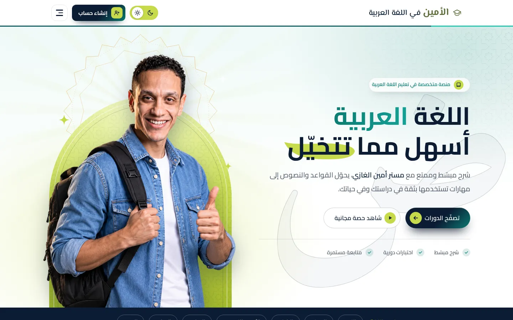

# منصة مستر أمين الغازي — نسخة محلية مُعاد بناؤها

[](https://github.com/abdelftahmohamed745-beep/aminelgazy-platform/actions/workflows/ci.yml)
[](https://aminelgazy-platform.vercel.app)
[](package.json)

- **الموقع المباشر:** <https://aminelgazy-platform.vercel.app>
- **المستودع:** <https://github.com/abdelftahmohamed745-beep/aminelgazy-platform>



إعادة بناء كاملة قابلة للتشغيل لموقع <https://www.aminelgazy.com/> بالعربية واتجاه RTL،
بدون أي اعتماديات خارجية في الواجهة، وبدون خدمات Firebase حقيقية. الصفحات منسوخة من
الموقع المرجعي ومعدّلة لتتصل بخادم محلي يوفّر الحسابات والجلسات والاشتراكات والنتائج.

> **تنبيه حقوق:** اسم «مستر أمين الغازي» والشعار والصور والنصوص التعليمية ملك لأصحابها.
> هذا المشروع عمل بحثي/تعليمي لإعادة البناء، وليس الموقع الرسمي ولا تابعًا له.

---

## 1) ما الذي يعمل

| المجال | الحالة |
|---|---|
| الصفحات العامة (رئيسية، كورسات، محاضرات، أسئلة شائعة، شروط، خصوصية، تواصل، 404) | ✅ |
| حسابات الطلاب: تسجيل، دخول، خروج، جلسات بكوكيز HttpOnly | ✅ |
| دخول «السنتر» بكود طالب | ✅ |
| تفعيل الكورسات بأكواد اشتراك (idempotent) | ✅ |
| صفحة الكورس، الدروس، مشغّل الفيديو، اختبار الدرس | ✅ |
| مركز الاختبارات، أداء الاختبار، تصحيح على الخادم، منع التسليم المكرر | ✅ |
| الملف الشخصي: البيانات، الاشتراكات، الكورسات المجانية، النتائج | ✅ |
| نموذج تواصل مع تحقق من الحقول وحفظ الرسائل | ✅ |
| الوضع الليلي، قائمة الجوال، فلاتر المحاضرات والبحث | ✅ |
| نشر على Vercel + تخزين دائم على Vercel Blob | ✅ |

---

## 2) التشغيل المحلي

```bash
git clone https://github.com/abdelftahmohamed745-beep/aminelgazy-platform.git
cd aminelgazy-platform
npm install          # التبعية الوحيدة: @vercel/blob (تُستخدم على Vercel فقط)
npm start            # http://127.0.0.1:4173
# أو
PORT=8080 HOST=0.0.0.0 npm start
```

- محليًا يعمل التخزين على `data/state.json`، ولا حاجة لأي خدمة خارجية.
- أول تشغيل ينسخ `data/seed.json` تلقائيًا (الحساب التجريبي + محاولتان).
- إعادة التشغيل لا تفقد البيانات.

### حساب تجريبي جاهز

| الحقل | القيمة |
|---|---|
| رقم الهاتف | `01000000000` |
| كلمة المرور | `246810` |
| الصف | الثالث الثانوي |
| الاشتراك | كورس الادب (`1788215964547`) |
| نتيجة سابقة | اختبار «التشبيه وعلامات الإعراب» ١٠٠٪ (١٢/١٢) |

### أكواد تفعيل الكورسات

| الكود | الكورس |
|---|---|
| `AMIN-ADAB` | كورس الادب للصف الثالث الثانوي |
| `AMIN-NAHW3` | كورس النحو — الوحدة الثالثة (النواسخ) |
| `AMIN-NAHW5` | كورس الوحدة الخامسة نحو — الثالث الثانوي |
| `AMIN-BAL2` | البلاغة الخاصة بالصف الثاني البكالوريا |
| `AMIN-NAHW1` | نحو الصف الأول الإعدادي |
| `AMIN-TASIS` | تأسيس المرحلة الثانوية في النحو |

### أكواد السنتر

| الكود | النتيجة |
|---|---|
| `AMIN-CENTER-1` / `AMIN-CENTER-2` | إنشاء/الدخول بحساب «طالب سنتر» تجريبي |

---

## 3) النشر

### 3.1 Vercel

المشروع منشور على <https://aminelgazy-platform.vercel.app> ومهيّأ للنشر التلقائي من
فرع `main`. للنشر اليدوي:

```bash
npm i -g vercel
vercel link
vercel --prod
```

إعدادات النشر في [`vercel.json`](vercel.json):

- الصفحات والأصول تُقدَّم من `public/` عبر شبكة Vercel الثابتة.
- كل مسارات `/api/*` تذهب إلى دالة Node واحدة: `api/[...path].js`.
- `includeFiles: data/**` يضمن شمول بيانات الكورسات والمحاضرات والاختبارات داخل الدالة.
- رؤوس أمان: `X-Content-Type-Options`, `Referrer-Policy`, `X-Frame-Options`, `Permissions-Policy`.
- تخزين مؤقت سنة كاملة لـ `/assets/*` (أسماء الملفات ثابتة).

### 3.2 التخزين على Vercel

Vercel Serverless بلا قرص دائم، لذلك يدعم المشروع ثلاث طبقات تخزين تلقائيًا:

| الأولوية | الطبقة | الاستخدام |
|---|---|---|
| 1 | `KV_REST_API_URL` + `KV_REST_API_TOKEN` | Upstash Redis / Vercel KV |
| 2 | `BLOB_READ_WRITE_TOKEN` | Vercel Blob — **المستخدم حاليًا** |
| 3 | ذاكرة العملية | احتياطي مؤقت (تُفقد البيانات مع كل بداية باردة) |
| — | ملف `data/state.json` | التشغيل المحلي |

الوضع النشط ظاهر دائمًا في `GET /api/health`:

```json
{ "ok": true, "storage": { "mode": "blob", "persistent": true, "path": "platform/state.json" } }
```

لاستخدام Blob في مشروع جديد:

```bash
vercel storage create aminelgazy-state --type blob --access private --region fra1
vercel storage connect aminelgazy-state --auth token --add-rw-token --yes
vercel env pull .env.local
```

وللاستخدام مع Upstash/Vercel KV أضف المتغيّرين `KV_REST_API_URL` و`KV_REST_API_TOKEN`
من لوحة Vercel ثم أعد النشر — لا تغيير في الشيفرة.

> ملاحظة: التخزين بأسلوب «آخر كتابة تفوز». هذا كافٍ لمنصة تجريبية، وليس بديلًا عن
> قاعدة بيانات علائقية عند وجود كتابة متزامنة كثيفة.

### 3.3 GitHub والنشر التلقائي

- المستودع مرتبط بمشروع Vercel، وكل دفع إلى `main` ينشئ نشرًا إنتاجيًا.
- سير عمل [`CI`](.github/workflows/ci.yml) يشغّل فحص الدخان على Node 20 و22 عند كل دفع/طلب سحب.

---

## 4) الصفحات والمسارات

| المسار | الوصف |
|---|---|
| `/` (`index.html`) | الرئيسية: هيرو، إحصاءات، الكورسات، عن المدرّس، المميزات، آراء الطلاب، تواصل |
| `/courses.html?grade=first-secondary` | كورسات الصف الأول الثانوي (فارغة كما في المرجع) |
| `/courses.html?grade=second-secondary` | كورسات الصف الثاني الثانوي — البكالوريا (كورس واحد) |
| `/courses.html?grade=third-secondary` | كورسات الصف الثالث الثانوي (٤ كورسات) |
| `/lectures.html` | مكتبة المحاضرات العامة (٣٤ محاضرة) مع الفلاتر والبحث والمشغّل |
| `/lectures.html#v=<youtube-id>` | رابط مباشر يفتح مشغّل المحاضرة |
| `/exam.html` | مركز الاختبارات: اختبارات جديدة + المحاولات المكتملة |
| `/test.html?quiz=<id>` | واجهة أداء الاختبار / عرض النتيجة |
| `/test.html?quiz=<id>&from=exams` | نفس الواجهة مع رابط عودة إلى مركز الاختبارات |
| `/course.html?course=<id>` | صفحة الكورس: الدروس، الأكورديون، مشغّل الفيديو، اختبار الدرس |
| `/auth.html#/choose` | اختيار نوع الحساب (خارجي / سنتر) |
| `/auth.html#/center` | الدخول بكود السنتر |
| `/auth.html#/register` | إنشاء حساب خارجي |
| `/auth.html#/signin` (و`#/login`) | تسجيل الدخول |
| `/profile.html` | الملف الشخصي: البيانات، الاشتراكات، الكورسات المجانية، كورساتي، الاختبارات |
| `/faq.html` | الأسئلة الشائعة (أكورديون) |
| `/terms.html` | الشروط والأحكام |
| `/privacy.html` | سياسة الخصوصية |
| `/contact.html` | تواصل معنا (نموذج مع تحقق حقيقي) |
| `/login.html` | تحويل إلى `auth.html` (كما في المرجع) |
| `/404.html` | صفحة غير موجودة مخصّصة |

روابط الإدارة (`dashboard.html`) مستبعدة عمدًا، ولا توجد أي بيانات اعتماد Firebase في المشروع.

---

## 5) المعمارية

```
aminelgazy-platform
├── server.js                 نقطة التشغيل المحلية (node server.js)
├── api/[...path].js          دالة Vercel لكل /api/*
├── lib/
│   ├── app.js                التوجيه، المصادقة، التحقق، التصحيح، تقديم الملفات
│   └── store.js              طبقة التخزين: file / blob / kv / memory
├── data/
│   ├── courses.json          بيانات الدورات العامة (9 كورسات)
│   ├── lectures.json         المحاضرات العامة (34 محاضرة)
│   ├── quizzes-index.json    فهرس الاختبارات (5، منها 3 منشورة)
│   ├── quizzes-full.json     بنك أسئلة محلي مؤلَّف (39 سؤالًا / 3 اختبارات)
│   ├── seed.json             الحالة الابتدائية (حساب تجريبي + محاولتان)
│   └── state.json            حالة التشغيل المحلية (غير متتبَّعة في git)
├── public/
│   ├── index.html … 404.html الصفحات (منسوخة من المرجع + تعديلات)
│   ├── assets/               صور وشعارات وأصول المرجع
│   ├── local/platform-data.js  تنفيذ محلي لواجهة AlaminData بدل Firestore
│   ├── local/local-db.js       واجهة شبيهة بـ Firestore لصفحات test/profile/exam
│   ├── enroll-widget.js        واجهة تفعيل الكورس بكود
│   ├── student-session.js      جلسة الطالب (تقرأ /api/me)
│   ├── student-courses.js, course-lessons.js, lectures.js, exams.js
│   ├── theme.js, mobile-header.js, splash.js
│   └── *.css                 تنسيقات المرجع + تنسيقات مساندة
├── tools/smoke-test.js       فحص دخان شامل (npm test)
├── vercel.json               إعدادات النشر والرؤوس
└── _evidence/                أدلة البحث والتحقق (لا تُنشر ولا تُخدم)
```

### كيف استُبدل Firebase

الموقع المرجعي يعتمد على Firebase Compat + مستندات `platform_data`. أُبقيت نفس أسماء
الدوال والواجهات (`AlaminData.courses/lectures/quizzes/attempts/student`,
`AlaminCourses`, `StudentSession`) لكن تنفيذها أصبح محليًا:

- `public/local/platform-data.js` يقرأ من `/api/data/*` مع تخزين مؤقت في `localStorage`.
- `public/local/local-db.js` يوفّر شكل `db.collection(...).doc(...)` الذي تتوقعه
  الصفحات المنسوخة، ويوجّهه إلى `/api/student`, `/api/attempts`, `/api/attempts/doc`.
- معرّف الطالب في المحاولات = `'web-' + user.id` كما في المرجع.

---

## 6) واجهات البرمجة

| الطريقة | المسار | الوظيفة |
|---|---|---|
| GET | `/api/health` | فحص الجاهزية + وضع التخزين |
| GET | `/api/data/courses` | كل الكورسات العامة |
| GET | `/api/data/lectures` | كل المحاضرات العامة |
| GET | `/api/data/quizzes` | فهرس الاختبارات المنشورة |
| GET | `/api/me` | الطالب الحالي أو `null` للزائر (200 دائمًا) |
| POST | `/api/register` | إنشاء حساب (هاتف مصري، كلمة مرور ٦ أرقام، صف) |
| POST | `/api/login` | تسجيل الدخول |
| POST | `/api/center-session` | الدخول بكود سنتر |
| POST | `/api/logout` | إنهاء الجلسة |
| GET | `/api/student` | بيانات الطالب + اشتراكاته |
| POST | `/api/enroll` | تفعيل كورس بكود اشتراك (idempotent) |
| GET | `/api/attempts` | محاولات الطالب |
| GET | `/api/attempts/doc?id=` | محاولة واحدة |
| POST | `/api/attempts` | تسليم اختبار (تصحيح على الخادم، رفض التكرار 409) |
| GET | `/api/quizzes/:id` | أسئلة اختبار متاح لحساب الطالب |
| POST | `/api/contact` | حفظ رسالة تواصل مع تحقق |

التصحيح والتحقق من الصلاحيات يحدثان على الخادم، لا في المتصفح. كلمات المرور تُخزَّن
بـ `scrypt` مع ملح عشوائي لكل مستخدم.

---

## 7) الاختبارات والتحقق

```bash
npm test
```

يشغّل الفحص خادمًا على منفذ عشوائي وملف حالة مؤقت، ثم يتحقق من:

- `/api/health` ووضع التخزين
- الصفحات الثماني الأساسية و404
- بيانات 9 كورسات و34 محاضرة و5 اختبارات
- بوابة الزائر (`/api/me` = null، `/api/student` = 401)
- دخول الحساب التجريبي، الاشتراك، المحاولات، وكلمة المرور الخاطئة (401)

**24/24 فحصًا ناجحًا محليًا**، وCI يشغّلها على Node 20 و22.

الأدلة التفصيلية في `_evidence/`:

| الحزمة | النتيجة |
|---|---|
| E2E مصادَق (تسجيل، بروفايل، تفعيل، كورس، مشغّل، اختبار، تكرار، تواصل، وضع ليلي، FAQ، خروج، سنتر، بوابة الزائر، 404) | **31/31** |
| التفاعلات (فلاتر المحاضرات، بحث، مشغّل، استبعاد اختبار الدرس، عدّادات الصفوف 0/1/4، روابط الصفوف، تسجيل مكرر/غير صالح، 401 للزائر، بوابة اختبار الصف، عزل الصف الأول) | **19/19** |
| واجهة معمّقة (خطأ/صحة الدخول، تبويبات البروفايل، رابط النتيجة، إخفاء التفعيل عن الزائر، شرائح المحاضرات، رابط مشغّل مباشر، تحقق التواصل، مراسي الرئيسية، قائمة الجوال) | **10/10** |
| مصفوفة الاستجابة 1440/768/390 (لا تجاوز أفقي، كل الصور تُحمَّل، RTL، فتح/إغلاق القائمة) | ناجحة |
| زحف الروابط الداخلية | 17 رابطًا، **0 مكسور** |
| مطابقة التخطيط مع المرجع (home, courses-g3, lectures, course-adab, profile, test, exams-guest) | مطابق في الأبعاد والارتفاعات |
| فحص الدخان النهائي للحساب التجريبي | ناجح بلا أخطاء كونسول أو شبكة |

الاختلافات المقصودة: تذييل الجوال أطول بـ ٣٨ بكسل بسبب رابط «تواصل معنا» العامل،
وصفحة `auth.html` بلا تذييل الموقع (كما في المرجع بالضبط). أخطاء الشبكة الوحيدة
المتوقعة أثناء الاختبارات: `404` لكود تفعيل خاطئ، `409` لتسليم مكرر، `401` لكلمة مرور خاطئة.

---

## 8) إعادة ضبط البيانات

```bash
# محليًا: أوقف الخادم ثم
rm -f data/state.json
npm start
```

يُعاد إنشاء الحالة من `data/seed.json` تلقائيًا. على Vercel، احذف
`platform/state.json` من متجر Blob أو استبدله بمحتوى `data/seed.json`.

---

## 9) حدود وملاحظات

- الخطوط من Google Fonts، ومشغّل الفيديو وصور المصغّرات من YouTube — تحتاج إنترنت.
- الأسئلة داخل الاختبارات مؤلَّفة محليًا؛ أسئلة الاختبارات الخاصة في الموقع المرجعي لم تُقرأ.
- لوحة تحكم الإدارة وبيانات اعتماد Firebase غير موجودة.
- التخزين على Vercel «آخر كتابة تفوز»؛ مناسب للعرض والاستخدام الخفيف.
- لا تُنشر بيانات `data/state.json` أو `_evidence/` على Vercel (مستبعدة عبر `.vercelignore`).

---

## 10) الترخيص

الشيفرة المصدرية بترخيص [MIT](LICENSE). المحتوى والعلامة التجارية والصور تخص
أصحاب الموقع المرجعي، ولا يمنح الترخيص حق إعادة استخدامها تجاريًا.
